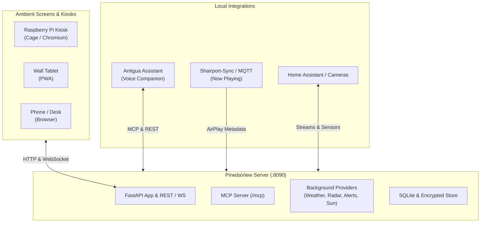

# PinedaView

A fast, local-first ambient dashboard server that turns spare screens, tablets, and dedicated Raspberry Pi kiosks into glanceable smart displays.

PinedaView pairs a lightweight, reactive **Svelte 5** client with an asynchronous **Python / FastAPI** backend. It operates entirely on your local network without external cloud dependencies, featuring an integrated **Model Context Protocol (MCP)** server for direct companion control via voice assistants like [antigua-assistant](https://github.com/flavanoids/antigua-assistant).



---

## Highlights

- **Reactive, Fluid Client:** Built in Svelte 5 with responsive CSS Grid layouts that automatically adapt from a 5-inch phone to a 24-inch wall monitor. Features three adaptive motion tiers so even resource-constrained devices (like a Raspberry Pi 4) run smooth, stutter-free 60fps animations.
- **Glanceable Card Library:**
  - **Weather & Atmosphere:** Open-Meteo multi-view conditions, RainViewer animated radar mosaic with storm-cell vectors, NWS emergency alerts, astronomical sun/moon phases, and air quality indices.
  - **Personal Photography:** Photo Clock with liquid glass numerals, Ken Burns spatial drift, EXIF capture dates, and local foreground depth cutouts. Scan a QR code from any phone to immediately drop photos onto the screen.
  - **Live Traffic & Commute:** Freeway speed maps, incident tracking, and live CCTV traffic camera rotations (customizable per screen).
  - **Schedule & Productivity:** Google and Apple CalDAV calendar synchronizations, countdown timers, and synchronized timer mirrors.
  - **Media & Telemetry:** AirPlay track info, album art, and home climate telemetry.
- **Companion Voice Integration:** Native Model Context Protocol (MCP) server at `/mcp` and REST endpoints allow voice assistants like [antigua-assistant](https://github.com/flavanoids/antigua-assistant) to change display themes, trigger fullscreen recipe ladders, query active photos or quotes, and manage kiosk lifecycles.
- **Multi-Screen Profiles:** Run one lightweight server that powers multiple independent displays. Each screen can have its own theme, custom card stack, layout density, and sleep schedule.
- **Local-First & Private:** All runtime data, uploaded photos, and credentials are encrypted at rest with machine-local keys. Includes an active local-network firewall guard (`pinedaview-guard`) to prevent accidental WAN exposure.

---

## Quick Start

### 1. Run with Docker

```bash
docker run -d \
  --name pinedaview \
  --restart unless-stopped \
  -p 8090:8090 \
  -v pinedaview-data:/data \
  ghcr.io/flavanoids/pinedaview:latest
```

Open `http://localhost:8090` in your browser to complete the first-run wizard.

### 2. Local Development

**Prerequisites:** Python 3.11+, Node.js 20+, `pnpm`.

```bash
# Clone repository
git clone https://github.com/flavanoids/PinedaView.git
cd PinedaView

# Install dependencies
pnpm install

# Start backend server
cd core
python3 -m venv .venv
source .venv/bin/activate
pip install -e ".[dev]"
pinedaview dev
```

Visit `http://localhost:8090` to load the application.

---

## Antigua Assistant Companion

PinedaView is designed to work out of the box with [antigua-assistant](https://github.com/flavanoids/antigua-assistant).

In your `antigua.yaml` configuration:

```yaml
pineda:
  url: http://127.0.0.1:8090
  profile: default
  reboot_delay_seconds: 10
  recipe_seconds: 120
```

With this configured, Antigua can naturally control your ambient screen:
- *"Switch the theme to ocean"*
- *"Show the recipe for chicken tikka masala"*
- *"Tell me more about this quote"*
- *"When was this photo taken?"*
- Mirror running kitchen timers directly into the dashboard stage.

For MCP configuration details and bearer token generation, see [`docs/MCP.md`](docs/MCP.md).

---

## Documentation

- **[Installation Guide](docs/INSTALL.md):** Docker, Linux packages (`.deb` / `.rpm`), and Raspberry Pi systemd kiosk setup.
- **[API Reference](docs/API.md):** Complete REST API and WebSocket events specification.
- **[MCP Guide](docs/MCP.md):** Model Context Protocol tools and permissions for AI assistants.
- **[Card SDK](docs/CARD_SDK.md):** Create your own custom dashboard cards and providers.
- **[Operations](docs/OPERATIONS.md):** Hardware notes, Wayland kiosk flags, and warm standby failover.

---

## License

[Apache 2.0](LICENSE) © [flavanoids](https://github.com/flavanoids)
