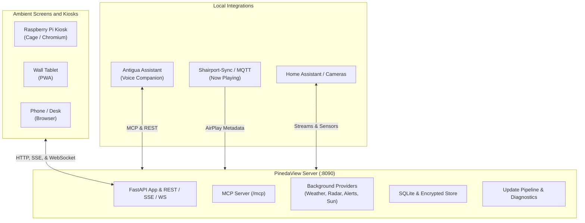

# PinedaView

A fast, local-first ambient dashboard server that turns spare screens, wall tablets, and dedicated Raspberry Pi kiosks into glanceable smart displays.

PinedaView pairs a reactive Svelte 5 frontend with an asynchronous Python / FastAPI backend. It runs entirely on your local network without external cloud dependencies, featuring an integrated Model Context Protocol (MCP) server for direct companion control via voice assistants like [antigua-assistant](https://github.com/flavanoids/antigua-assistant).



---

## Features

### Reactive Display Engine
- **Fluid Svelte 5 Client:** Responsive CSS Grid layouts that automatically adapt from a 5-inch phone to a 24-inch wall monitor.
- **Three Adaptive Motion Tiers:** Weak GPUs (like Raspberry Pi 4) are detected automatically and assigned optimized render profiles to sustain clean 60fps animations without dropped frames.
- **Dynamic Shuffle and Ambient Loop:** Smoothly promotes each dashboard card into a prominent Hero position using 60fps GPU-accelerated FLIP animations with configurable dwell time. Seamlessly weaves between dashboard telemetry and photography.
- **Multi-Screen Profiles:** A single lightweight server drives multiple independent displays. Each screen maintains its own theme, custom card stack, layout density, and sleep schedule.

### Screen Turning and Tall Orientation
- **Dynamic Rotation:** Turn displays 0 deg, 90 deg, 180 deg, or 270 deg via the REST API (`PUT /api/control/rotation`), the phone companion menu, or the MCP voice assistant tool (`screen_turn`). Rotate without touching display cables or physical mounts.
- **Tall Screen Optimization:** Portrait orientations automatically stack two-figure hours (`06` over `41`), adapt font scaling to screen width, prioritize tall aspect ratio photography, and intelligently center wide photos on detected subjects.

### Photo Clock with Glass Optics and Depth
- **Liquid Glass Numerals:** Time numerals rendered with real-time refraction, whole-stroke lens shaders, sandblasted frost finishes, and contact drop shadows.
- **Automated Depth Cutouts:** Local AI foreground segmentation cleanly layers clock numerals behind people and subjects in personal photos.
- **3D Spatial Drift:** Subtle 1.00x to 1.04x Ken Burns spatial zoom with anchored foreground cutouts.
- **Ambient Memory Whisper:** Gentle contextual fade-in of capture date, year, and location from photo EXIF metadata.
- **Integrated Date Pill:** Real-time temperature and weather condition glyphs embedded directly inside the date badge.
- **Instant Photo Drop:** Scan a QR code from any smartphone to instantly drop photos onto the ambient screen without installing apps.

### Interactive Takeovers and Recipe Box
- **Recipe Choices Takeover:** Fullscreen multi-choice recipe selection with step-by-step progress ladders, ingredient cards, and picture galleries.
- **Recipe Box Management:** Browse, save, and pin favorite recipes from the phone companion menu (`/menu`) or through natural voice commands.
- **Image Search and Dynamic Collage:** Instant multi-image collage takeover with animated layouts and a secure local image proxy featuring SSRF protection and caching.
- **Emergency and Camera Takeovers:** Live RTSP camera streams, Home Assistant events, and NWS emergency alert broadcasts preempt ambient cards and dismiss automatically.

### Glanceable Card Library
- **Weather and Atmosphere:** Open-Meteo multi-view conditions, hourly forecast walks, RainViewer animated radar mosaics with NEXRAD storm-cell vectors, astronomical sun/moon phases, and air quality indices.
- **Live Traffic and Commute:** Freeway speed maps, incident tracking, and live DOT CCTV traffic camera rotations customizable per screen.
- **Schedule and Productivity:** Google Calendar (OAuth) and Apple iCloud Calendar (CalDAV) synchronizations with phone QR setup, countdowns, and synchronized kitchen timers.
- **Media and Telemetry:** AirPlay track metadata and album art via shairport-sync / MQTT, plus home climate telemetry.

### Automated Updates with Zero Downtime
- **Production-Grade GitHub Updates:** Built-in automated update runner (`scripts/pinedaview-update.sh`) pulling from `https://github.com/flavanoids/PinedaView.git` on `main`.
- **Pre-Flight Validation:** Stashes local changes, verifies git branches, compiles frontend assets, and executes smoke checks before activating new builds.
- **Automatic Health Check and Rollback:** Restarts the systemd service, monitors `/api/health`, and automatically rolls back to the prior working commit if health verification fails.
- **Live Visual Kiosk Overlay:** On-screen progress overlay (`UpdateOverlay.svelte`) and Server-Sent Events (`/api/system/update/stream`) inform users of update progress and countdown restarts.
- **Diagnostic Pipeline:** Automated self-test script (`scripts/test-update-pipeline.sh`) validates git remotes, systemd services, sudoer permissions, and kiosk communication.

### Security and Privacy
- **Local-First Architecture:** All runtime data, uploaded photos, and credentials are encrypted at rest with machine-local keys.
- **Local Network Guard:** Built-in network firewall rules (`pinedaview-guard`) safeguard against accidental public WAN exposure.
- **Safe Proxying:** Built-in image proxy restricts requests to public IP ranges and validates image MIME types, preventing SSRF attacks on local networks.

---

## Quick Start

### 1. Run with Docker

```bash
docker run -d \
  --name pinedaview \
  --restart unless-stopped \
  -p 8090:8090 \
  -v pinedaview-data:/data \
  ghcr.io/flavanoids/pinedaview:latest
```

Open `http://localhost:8090` in your browser to complete the first-run wizard.

### 2. Install on Linux (Debian / Ubuntu / Raspberry Pi OS)

Download the latest `.deb` package from [Releases](https://github.com/flavanoids/PinedaView/releases):

```bash
sudo dpkg -i pinedaview_1.0.0_arm64.deb
sudo systemctl enable --now pinedaview.service
```

### 3. Local Development

Prerequisites: Python 3.11+, Node.js 20+, and pnpm.

```bash
# Clone the repository
git clone https://github.com/flavanoids/PinedaView.git
cd PinedaView

# Install frontend dependencies and build assets
pnpm install
pnpm run check

# Set up Python backend
cd core
python3 -m venv .venv
source .venv/bin/activate
pip install -e ".[dev]"

# Start development server
pinedaview dev
```

Visit `http://localhost:8090` to load the application.

---

## Automated Updates

PinedaView includes a dedicated systemd timer and update script configured to track the public repository:

```bash
# Check update status
curl -s http://localhost:8090/api/system/update | jq .

# Trigger an update immediately
sudo /opt/pinedaview/bin/pinedaview-update.sh

# Run the update pipeline diagnostic test
sudo /opt/pinedaview/bin/test-update-pipeline.sh
```

To enable nightly automated updates at 03:00 local time:

```bash
sudo systemctl enable --now pinedaview-update.timer
```

---

## Antigua Voice Assistant Integration

PinedaView natively pairs with [antigua-assistant](https://github.com/flavanoids/antigua-assistant), a local voice companion.

### Configuration

Add the PinedaView connection to your `antigua.yaml` configuration:

```yaml
pineda:
  url: http://127.0.0.1:8090
  profile: default
  reboot_delay_seconds: 10
  recipe_seconds: 120
```

### Voice Commands

Once connected, Antigua can control the display directly:
- "Switch the theme to ocean"
- "Show the recipe for chicken tikka masala"
- "Turn the screen 90 degrees"
- "Tell me more about this photo"
- "Mirror my kitchen timer for 12 minutes"

Antigua interacts with PinedaView via the Model Context Protocol (MCP) server at `/mcp` and REST endpoints. For tool definitions and authentication details, see [`docs/MCP.md`](docs/MCP.md).

---

## Documentation

- **[Installation Guide](docs/INSTALL.md):** Complete setup for Docker, Linux packages, Raspberry Pi kiosks with `cage` and Chromium, and split-host setups.
- **[Operations Guide](docs/OPERATIONS.md):** Hardware configuration, display rotation, automated updates, diagnostics, and high-availability standby failover.
- **[Model Context Protocol (MCP)](docs/MCP.md):** AI agent tools, schema definitions, and voice assistant integration.
- **[API Reference](docs/API.md):** Complete REST API, Server-Sent Events, and WebSocket specification.
- **[Card SDK](docs/CARD_SDK.md):** Build custom dashboard cards, visual layouts, and backend data providers.

---

## License

[Apache 2.0](LICENSE) (c) [flavanoids](https://github.com/flavanoids)
